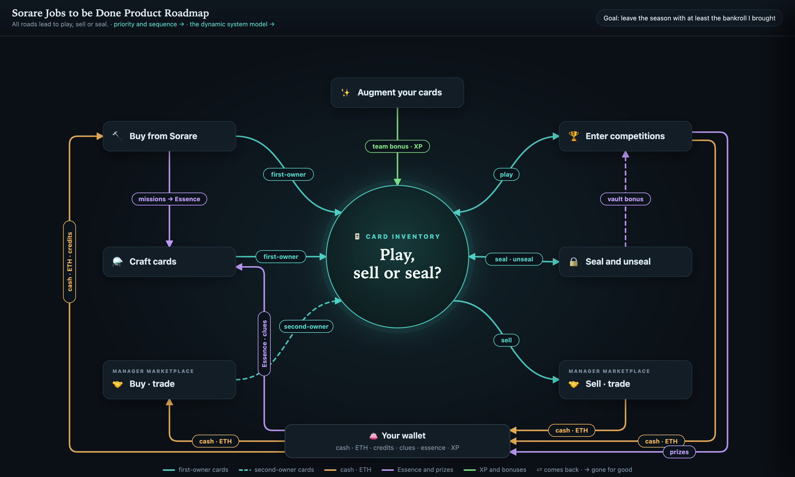
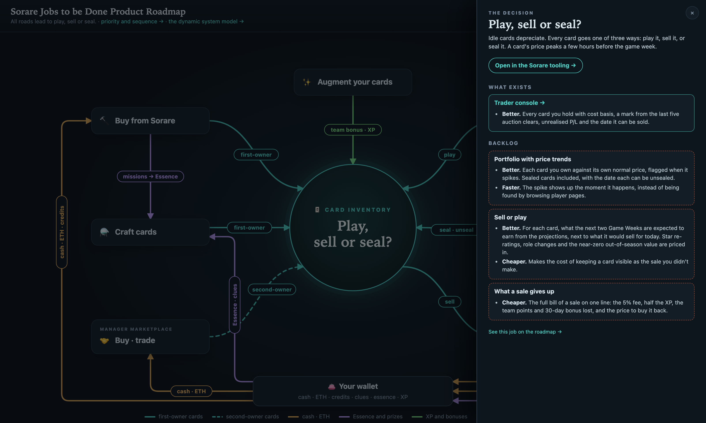

# Jobs-to-be-Done product map · working prototype

A product visualization built as three pages over one data file. The first
instance is Danvers' Sorare NBA tooling; the schema is meant to fit any product.

| File | What it is |
|---|---|
| `roadmap.html` | **The jobs map.** Eight jobs around the one decision, arrows coloured by what moves. Click a job for its room: the product page that serves it, what exists and how it beats doing the job by hand, then the backlog in priority order. |
| `plan.html` | **Priority and sequence.** Features ranked by score against the season's phases, and every job against better, cheaper, faster. The quiet part, made visible. |
| `v2.html` | **The dynamic system model.** Stocks, flows, tolls and time; the detailed model the map was simplified from. |
| `sorare.jobs.json` | The data: stocks, jobs, flows, phases, cells, features, priority inputs. Edit this. |
| `SCHEMA.md` | What each field means and the six decisions the structure encodes. |
| `check.py` | Validates the data file; also resolves `cards` names against the Sorare context library when present. |
| `build.py` | Runs the check and writes `sorare.jobs.js`, which the pages load (browsers block `fetch` over `file://`). |
| `jobs-lib.js` | Shared derivations (cell status, scoring, what serves a job) so the pages can't disagree. |

Open any page straight from disk. After editing the JSON, run `python3 build.py`.

## Status

Working prototype, 2026-10-29. Not wired into the viewer. Open questions are in
the conversation that produced it; the short list:

- Whether the roadmap's "Built" column earns its space.
- Whether the score should weight depth on the decision over breadth across jobs.
- Every feature's served status is `inferred` from READMEs, not audited.

